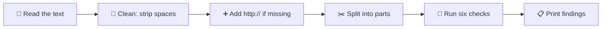
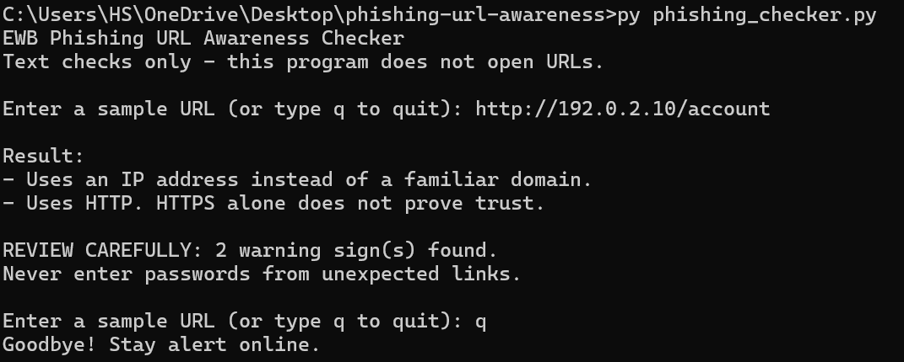
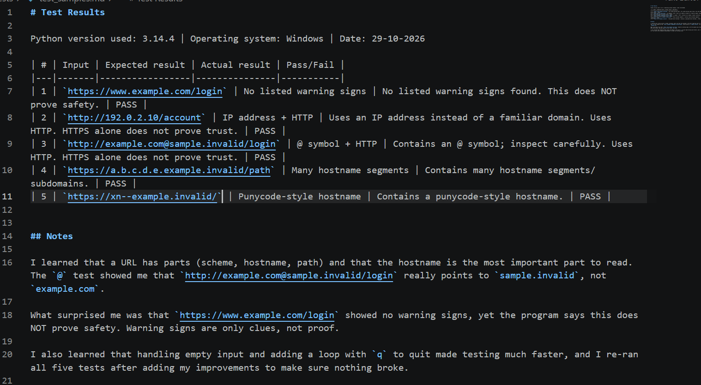

<div align="center">

# 🛡️ EWB Phishing URL Awareness Checker

**Read the link. Spot the clues. Stay alert.**


🔍 Reads the **text** of a URL and points out warning signs. It never opens the link.

</div>

---

## 📑 Contents
[Overview](#-overview) · [Quick Start](#-quick-start) · [Features](#-features) · [How It Works](#-how-it-works) · [Warning Signs](#-the-six-warning-signs) · [Project Structure](#-project-structure) · [Requirements](#-requirements) · [How to Run](#-how-to-run) · [Example Output](#-example-output) · [Testing](#-testing) · [Screenshots](#-screenshots) · [Improvements](#-improvements) · [Limitations](#-limitations) · [Ethical Use](#-ethical-use) · [Additional Document](#-additional-document) · [Author](#-author)

---

## 📖 Overview
Phishing is a trick where criminals send fake links or messages to make people share passwords, card numbers or OTPs. This project is a small Python command-line tool that reads the text of a URL and points out selected warning signs. It only inspects the text. It never opens or visits the URL.

## ⚡ Quick Start
```
py phishing_checker.py
```
Then type a sample URL such as `http://192.0.2.10/account` and press Enter. Type `q` to quit.

## ✨ Features
- 🔸 Detects an @ symbol in the URL
- 📏 Flags unusually long URLs (over 100 characters)
- 🔢 Flags IP-address hostnames
- 🌐 Flags many hostname segments (5 or more)
- 🔤 Flags punycode-style hostnames (xn--)
- 🔓 Flags the HTTP scheme
- 🔁 Loop mode: check several URLs in one run, type q to quit
- ⚠️ "REVIEW CAREFULLY" summary with the number of warning signs found

## 🔄 How It Works

The program only handles text. It has no network code, so it cannot visit a URL.

## 🚩 The Six Warning Signs

| # | Warning sign | Why it matters |
|---|---|---|
| 1 | 🔸 `@` symbol | The browser ignores the text before `@`, so a link can look like one site but go to another |
| 2 | 📏 URL longer than 100 characters | Long links can hide the real destination |
| 3 | 🔢 IP address as hostname | Real brands normally use names, not numbers |
| 4 | 🌐 5 or more hostname segments | Stacked names can make a link look official |
| 5 | 🔤 `xn--` punycode marker | Can hide look-alike foreign letters |
| 6 | 🔓 HTTP instead of HTTPS | HTTP is not encrypted |

<details>
<summary>🤔 Why is "no warning signs" not the same as "safe"?</summary>

These are clues, not proof. A link with zero clues can still be dangerous, for example a name with a slightly wrong spelling. A link with clues can also be harmless. This tool checks only six clues, so it can never prove that a URL is safe.

</details>

## 🗂️ Project Structure
```
phishing-url-awareness/
├── phishing_checker.py                        # the Python program
├── README.md                                  # this file
├── requirements.txt                           # no extra packages needed
├── EWB_Cyber_Assessment01_Gopal_Mankar.pdf    # Assessment 01: Security Foundations
├── tests/
│   └── test_samples.md                        # test evidence table
└── screenshots/
    ├── sample_run.png                         # one program run
    └── test_results.png                       # proof of the tests
```

## 📦 Requirements
Python 3.10 or later. No extra packages.

## ▶️ How to Run
Windows: `py phishing_checker.py` (or `python phishing_checker.py`)

Mac/Linux: `python3 phishing_checker.py`

## 💻 Example Output
```
EWB Phishing URL Awareness Checker
Text checks only - this program does not open URLs.

Enter a sample URL (or type q to quit): http://192.0.2.10/account

Result:
- Uses an IP address instead of a familiar domain.
- Uses HTTP. HTTPS alone does not prove trust.

REVIEW CAREFULLY: 2 warning sign(s) found.
Never enter passwords from unexpected links.

Enter a sample URL (or type q to quit): q
Goodbye! Stay alert online.
```

## 🎯 Try It Yourself
Use only these sample strings. They use reserved example-style domains and documentation IP space.

| Type this | You should see |
|---|---|
| `https://www.example.com/login` | No listed warning signs found |
| `http://192.0.2.10/account` | IP address + HTTP warnings |
| `http://example.com@sample.invalid/login` | @ symbol + HTTP warnings |
| `https://a.b.c.d.e.example.invalid/path` | Many hostname segments warning |
| `https://xn--example.invalid/` | Punycode-style hostname warning |

## 🧪 Testing
Full table is in `tests/test_samples.md`.

| # | Input | Expected | Actual | Result |
|---|-------|----------|--------|--------|
| 1 | `https://www.example.com/login` | No warning signs | No listed warning signs found. This does NOT prove safety. | ✅ PASS |
| 2 | `http://192.0.2.10/account` | IP address + HTTP | IP address and HTTP warnings shown | ✅ PASS |
| 3 | `http://example.com@sample.invalid/login` | @ symbol + HTTP | @ symbol and HTTP warnings shown | ✅ PASS |
| 4 | `https://a.b.c.d.e.example.invalid/path` | Many hostname segments | Many hostname segments warning shown | ✅ PASS |
| 5 | `https://xn--example.invalid/` | Punycode-style hostname | Punycode-style hostname warning shown | ✅ PASS |

## 📸 Screenshots
**Sample run**



**Test results**



## 🚀 Improvements
1. **🔁 Loop with quit** - Earlier the program checked only one URL and then closed. I replaced the single input with a `while True` loop, so I can check many URLs in one run. Typing `q`, `quit` or `exit` stops the loop. I chose it because it makes testing faster. I tested it by entering several URLs one after another, then an empty input, then `q`, and the program ended with "Goodbye!".
2. **⚠️ "Review carefully" summary** - I added a helper function `has_warnings()` that separates real warnings from information messages such as "No URL entered". When real warnings are found, the program prints "REVIEW CAREFULLY" with the number of warning signs. I tested it: it appeared for `http://192.0.2.10/account` (2 warnings), and it did not appear for `https://www.example.com/login` or for empty input.

## ⚠️ Limitations
This is an educational tool. It only reads URL text. It does not visit
URLs, scan for malware or prove that a URL is safe. No warning signs
found does NOT mean a URL is safe.

## 🤝 Ethical Use
Use sample strings only. Do not collect credentials. Do not use this
project to deceive anyone or to test websites without permission.

## 📎 Additional Document
This repository also includes `EWB_Cyber_Assessment01_Gopal_Mankar.pdf`, my EWB Assessment 01 (Security Foundations), uploaded as instructed by the EWB team. It is separate from the Phishing URL Awareness Checker mini project.

## 👤 Author
Gopal Mankar, AI Powered Cybersecurity Internship, EWB Courses
